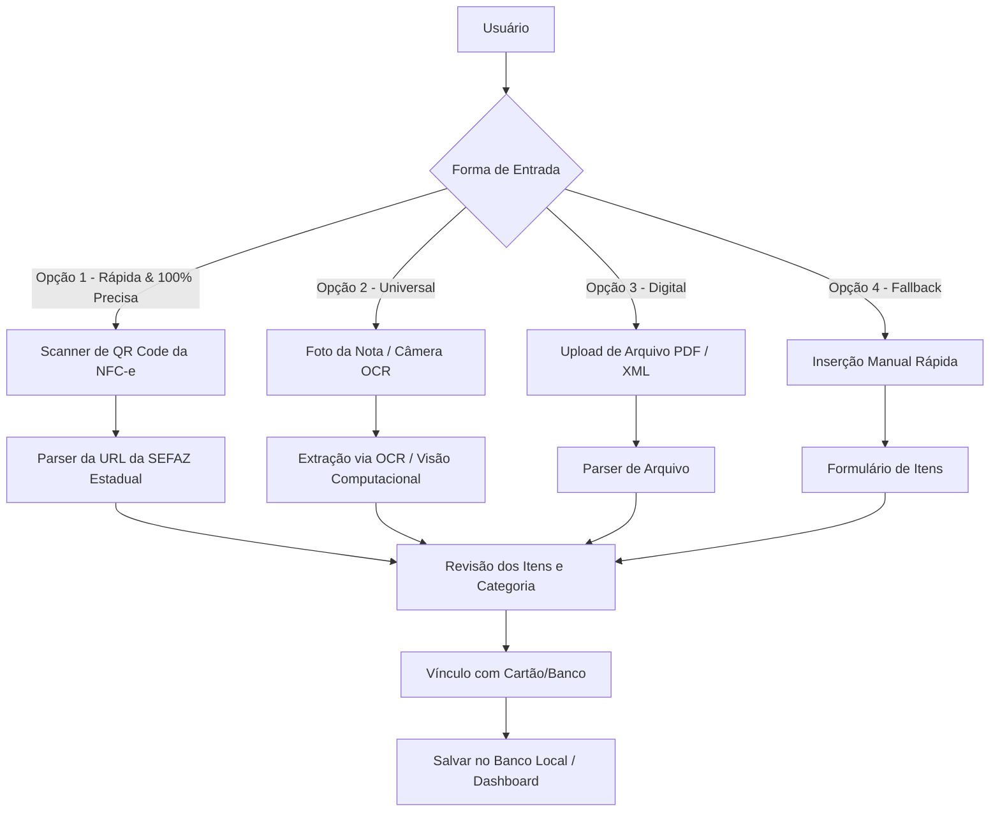

# 📄 Documento de Especificação de Projeto: NotaControl PWA

> **Aplicativo Web Progressivo (PWA) para Gestão Financeira Inteligente via Leitura de Notas Fiscais**

---

## 1. Visão Geral do Produto

O **NotaControl** (nome preliminar sugerido) é um aplicativo **PWA (Progressive Web App)** voltado para o controle financeiro pessoal simplificado e detalhado. Ao invés de exigir digitação manual e tediosa de cada gasto, o usuário simplesmente **tira uma foto ou lê o QR Code da nota fiscal (NFC-e)**.

O sistema extrai os itens da nota, categoriza automaticamente cada produto (alimentação, limpeza, farmácia, lazer, etc.), permite associar a compra a um banco ou cartão específico, e gera dashboards interativos com visualizações por **dia, semana, mês e ano**.

### 1.1. Principais Diferenciais
* **Instalável e Leve (PWA):** Funciona como app nativo no celular (Android e iOS) e no computador, sem necessidade de publicação prévia em lojas de aplicativos.
* **Local-First & Offline:** Permite registrar notas e consultar gastos mesmo sem sinal de internet, sincronizando quando disponível.
* **Detalhamento no Nível do Item:** Ao invés de registrar apenas "Gastei R$ 350 no Mercado X", registra *o que* foi comprado e quanto custou cada coisa.
* **Multi-cartões / Multi-bancos:** Separação precisa de qual fatura ou conta foi debitada.

---

## 2. Métodos de Entrada da Nota Fiscal

Para garantir máxima assertividade e rapidez, o app contemplará 3 formas de captura:



1. **Scanner de QR Code da NFC-e (Recomendado):**
   - Quase toda nota de mercado, restaurante ou farmácia no Brasil possui um QR Code de Nota Fiscal de Consumidor Eletrônica (NFC-e).
   - O app lê o QR Code com a câmera do celular em menos de 1 segundo.
   - O link da SEFAZ contém os dados oficiais da compra (itens, quantidade, valor unitário, tributos e CNPJ).
2. **Foto da Nota (OCR com Inteligência Artificial):**
   - Para recibos comuns ou notas onde o QR Code está rasgado ou inelegível.
   - Algoritmo de OCR (Tesseract.js para leitura local ou Gemini Vision API para ultra-precisão) identifica: Nome do estabelecimento, Data, Lista de Itens, Valores e Total.
3. **Upload de PDF / XML ou Imagem da Galeria:**
   - Permite subir compras feitas pela internet ou cupons fiscais salvos.
4. **Edição e Inserção Manual:**
   - O usuário pode ajustar nomes, valores, adicionar ou remover itens antes de salvar.

---

## 3. Gestão de Bancos, Contas e Cartões

Muitas pessoas utilizam múltiplos cartões (ex: Nubank para compras online, Cartão Vale Alimentação/Refeição para mercado, Itaú para contas fixas, Dinheiro ou Pix).

### Funcionalidades deste módulo:
* **Cadastro Personalizado de Formas de Pagamento:**
  - Nome (Ex: *Nubank Ultravioleta*, *Alelo Alimentação*, *Inter Débito*, *Dinheiro/Pix*).
  - Tipo: Crédito, Débito, Vale Benefício (VR/VA), Dinheiro ou Pix.
  - Bandeira / Cor de identificação visual para facilitar nos gráficos.
  - Dia de fechamento e dia de vencimento da fatura (para alocar o gasto no mês correto).
* **Associação Rápida:**
  - Na tela de confirmação da nota, o app sugere o meio de pagamento (detectado no cupom) ou permite selecionar com 1 clique o cartão utilizado.
* **Filtros e Relatórios por Cartão:**
  - Saiba exatamente quanto já foi comprometido na fatura de cada cartão antes mesmo do fechamento.

---

## 4. Categorização Inteligente de Produtos

Cada item de uma compra de mercado pode pertencer a uma categoria diferente (ex: em uma mesma compra de R$ 300, R$ 180 é comida, R$ 70 é produto de limpeza e R$ 50 é higiene pessoal).

### 4.1. Categorias Padrão
* 🛒 **Alimentação & Mercado:** Carnes, laticínios, verduras, bebidas, grãos, petiscos.
* 🧹 **Casa & Limpeza:** Desinfetante, sabão em pó, papel toalha, utilidades domésticas.
* 💊 **Saúde & Farmácia:** Medicamentos, curativos, vitaminas, dermocosméticos.
* 🧼 **Higiene & Cuidados Pessoais:** Sabonete, shampoo, pasta de dente, desodorante.
* 🍔 **Lazer & Restaurantes:** Bares, restaurantes, cinema, delivery.
* 🚗 **Transporte & Combustível:** Gasolina, etanol, estacionamento, Uber.
* 👕 **Vestuário & Acessórios:** Roupas, calçados.
* 📦 **Outros / Gerais:** Gastos não classificados.

### 4.2. Motor de Classificação Automática
* Dicionário local inteligente que aprende com o usuário.
  - Exemplo: Detectou `"SAB PO OMO 1.6KG"` $\rightarrow$ Categoria **Casa & Limpeza**.
  - Detectou `"LEITE DESN PIRAC 1L"` $\rightarrow$ Categoria **Alimentação & Mercado**.
* Se o usuário alterar uma categoria, o app memoriza a preferência para as próximas notas.
* Suporte a criação de categorias e subcategorias personalizadas.

---

## 5. Dashboard & Painel de Controle

O dashboard será focado em clareza, velocidade e usabilidade mobile-first.

### 5.1. Visualizações Temporais
* **Hoje:** Total gasto no dia e lista das compras do dia.
* **Semana Atual:** Acompanhamento do ritmo de gastos semanal com comparativo.
* **Mês Atual:** Visão consolidada da fatura e despesas com projeção até o final do mês.
* **Ano:** Visão macro mês a mês para entender meses com picos de consumo (ex: dezembro, férias).

### 5.2. Componentes Visuais do Painel
* **Alerta de Validade (Banner inteligente no topo):** Caso haja produtos que estão para vencer nos próximos dias ou que foram identificados com data já vencida na compra, exibe um aviso logo ao abrir o app.
* **Cards Resumo:** Total Gasto, Média Diária, Maior Despesa e Cartão Mais Utilizado.
* **Gráfico de Pizza / Donut:** Distribuição percentual por Categoria de Produto.
* **Gráfico de Barras / Linhas:** Evolução temporal dos gastos (comparando mês atual vs. mês anterior).
* **Distribuição por Meio de Pagamento:** Quanto foi em Crédito, Débito, VA/VR e Pix.
* **Top 5 Produtos que mais pesaram no orçamento.**

### 5.3. Busca e Filtros Avançados
* Campo de busca instantânea (ex: buscar "picanha", "cerveja" ou "paracetamol" para ver quando e quanto gastou).
* Filtros por:
  - Período (data inicial e final, hoje, últimos 7 dias, mês específico).
  - Categoria.
  - Estabelecimento / Supermercado.
  - Banco / Cartão.
  - Faixa de valor (R$).

---

## 6. Ideias Inovadoras e Funcionalidades Extras (Diferenciais)

Para tornar o aplicativo indispensável, adicionamos as seguintes propostas:

| Funcionalidade | Descrição | Impacto |
| :--- | :--- | :--- |
| 📈 **Histórico de Preço de Itens (Inflação Pessoal)** | Permite consultar quanto você pagava no leite, café ou azeite há 3 meses e em qual mercado estava mais barato. | **Altíssimo** (Ajuda direta a economizar) |
| 🔔 **Alerta de Validade e Vencimento de Produtos** | Notificações push e aviso destacado ao abrir o aplicativo sobre produtos que irão vencer nos próximos dias ou que já estão vencidos (útil caso tenha comprado sem perceber algum produto vencido na gôndola). | **Alto** (Evita desperdício e prejuízo) |
| 🎯 **Metas & Orçamentos (100% Opcional)** | Para quem quiser acompanhamento restritivo: define limites mensais por categoria. Se o usuário preferir não usar, o app opera livremente sem cobranças de meta. | **Opcional** (Não interfere no uso padrão) |
| 💡 **Insights Automáticos** | Avisos simples de consumo: *"Você gastou 15% menos em mercado nesta semana em relação à anterior!"* | **Médio** (Feedback positivo) |
| 📤 **Exportação de Dados (Minimalista & Discreta)** | Opção secundária e discreta no menu de Configurações para exportação em CSV/Excel (backup raro, sem poluir a interface principal). | **Baixo** (Acesso pontual quando necessário) |
| 🔒 **Privacidade Total (Local-First)** | Dados armazenados no próprio dispositivo via IndexedDB. Nenhuma informação de consumo pessoal é vendida para terceiros. | **Segurança & Ética** |

---

## 7. Arquitetura Técnica do Frontend (PWA)

```
┌────────────────────────────────────────────────────────┐
│                   NotaControl PWA                      │
├────────────────────────────────────────────────────────┤
│  UI / Apresentação: React 18+ com TypeScript & Tailwind│
│  Ícones: Lucide React | Gráficos: Recharts / Chart.js  │
├────────────────────────────────────────────────────────┤
│  Mecanismo de Captura:                                 │
│  - Leitor QR Code: html5-qrcode / @zxing               │
│  - OCR: Tesseract.js (local) + Gemini Vision (opcional)│
├────────────────────────────────────────────────────────┤
│  Camada de Dados & Armazenamento Offline:              │
│  - IndexedDB através do Dexie.js (banco local veloz)   │
│  - LocalStorage para preferências e configurações      │
├────────────────────────────────────────────────────────┤
│  Service Worker & PWA:                                 │
│  - vite-plugin-pwa (Workbox para Cache Offline total)  │
│  - Web App Manifest (instalação no Android/iOS/Desktop)│
└────────────────────────────────────────────────────────┘
```

### 7.1. Stack Recomendada para o Frontend
* **Vite + React (TypeScript):** Inicialização ultra-rápida, tipagem segura e ecossistema maduro.
* **Tailwind CSS:** Design moderno, responsivo, mobile-first, suporte nativo a Dark Mode.
* **Lucide React:** Conjunto completo de ícones modernos e leves.
* **Recharts:** Biblioteca flexível e responsiva para gráficos de pizza, barras e linhas.
* **Dexie.js (IndexedDB):** Banco de dados relacional no navegador do usuário, capaz de armazenar milhares de notas e itens sem lentidão.
* **html5-qrcode:** Leitura instantânea de QR Code com a câmera do celular no navegador.
* **Tesseract.js / Web Worker:** OCR local que roda em segundo plano sem travar a interface.
* **vite-plugin-pwa:** Configuração de Service Workers, funcionamento offline e manifesto PWA.

---

## 8. Modelagem de Dados do Frontend (Schemas TypeScript)

```typescript
// Meio de Pagamento / Cartão / Banco
export interface PaymentMethod {
  id: string;
  name: string; // Ex: "Nubank", "Alelo", "Itaú"
  type: 'credit' | 'debit' | 'benefit' | 'cash' | 'pix';
  color: string; // Cor hex para tags e gráficos
  closingDay?: number; // Dia de fechamento da fatura
  dueDay?: number; // Dia de vencimento da fatura
  isDefault?: boolean;
}

// Categoria de Produto
export interface Category {
  id: string;
  name: string; // Ex: "Alimentação & Mercado"
  color: string;
  icon: string; // Nome do ícone Lucide
  budgetLimitMonthly?: number; // Opcional: Orçamento mensal para quem desejar acompanhamento
}

// Item Individual da Nota
export interface ReceiptItem {
  id: string;
  receiptId: string;
  name: string; // Ex: "Iogurte Natural 170g"
  originalRawName: string; // Como veio impresso na nota
  quantity: number;
  unitPrice: number;
  totalPrice: number;
  categoryId: string;
  expirationDate?: string; // Opcional: data de validade estimada ou informada
  isExpiredAlert?: boolean; // Alerta caso o produto vença logo ou já tenha sido comprado vencido
}

// Nota Fiscal Completa
export interface Receipt {
  id: string;
  storeName: string; // Nome do supermercado/loja
  storeCnpj?: string;
  date: string; // ISO Date "2026-11-16T18:30:00"
  totalAmount: number;
  paymentMethodId: string;
  items: ReceiptItem[];
  imageUrl?: string; // Foto opcional salva em blob/base64
  qrCodeUrl?: string; // URL da SEFAZ caso tenha sido via QR Code
  notes?: string; // Observações extras
  createdAt: string;
}
```

---

## 9. Estrutura de Telas / Wireframes Conceituais

### 1. **Tela Inicial / Dashboard (`/`)**
* **Banner de Alerta de Validade (Topo):** Mensagem de atenção imediata ao entrar no app caso existam produtos próximos do vencimento ou que foram identificados com data já vencida na compra.
* Barra superior: Saldo total gasto no mês, seletor de mês/ano, botão rápido de alternar tema escuro/claro.
* Seletor de período rápido: **Dia | Semana | Mês | Ano**.
* Gráficos interativos de categorias e evolução temporal.
* Resumo dos cartões: quanto foi gasto em cada um.
* Ações rápidas flutuantes: Botão grande central com ícone de câmera para escanear nova nota.

### 2. **Tela de Escaneamento / Nova Nota (`/scan`)**
* Alternador de modo: **Escanear QR Code** ou **Tirar Foto / Subir Imagem**.
* Visor da câmera em tela cheia com guias de alinhamento.
* Feedback visual e sonoro de leitura confirmada.

### 3. **Tela de Revisão e Confirmação (`/receipts/new`)**
* Exibição dos dados gerais: Estabelecimento, Data, Total.
* Dropdown para selecionar o **Cartão / Banco** utilizado.
* Lista expansível de itens extraídos:
  - Cada item exibe Nome, Quantidade, Preço e uma etiqueta com a Categoria sugerida.
  - Clique na etiqueta para trocar a categoria rapidamente.
* Botão de adicionar item faltante ou excluir item incorreto.
* Botão **Salvar e Adicionar ao Dashboard**.

### 4. **Tela de Histórico e Busca de Compras (`/receipts`)**
* Barra de pesquisa com auto-complete de produtos e lojas.
* Filtros rápidos por cartão, categoria e período.
* Lista de compras agrupadas por data com detalhes expansíveis.

### 5. **Tela de Monitoramento de Preços / Inflação Pessoal (`/prices`)**
* Busca por produto (ex: "Leite").
* Gráfico de linha mostrando o preço unitário ao longo dos meses e onde esteve mais barato.

### 6. **Tela de Cartões e Contas (`/wallets`)**
* Gerenciamento de cartões de crédito, débito, vales e bancos.
* Resumo de gastos da fatura atual de cada cartão.

### 7. **Módulo de Metas & Orçamentos (100% Opcional - Desativado por padrão)**
* Para usuários que desejarem controle estrito de teto de gastos.
* Se desativado, o app funciona com foco exclusivo em registro e visualização de consumo sem cobrar metas.
* Configuração de limites mensais por categoria com alertas visuais.

### 8. **Configurações & Backup (`/settings`)**
* Gerenciamento de preferências gerais (notificações de vencimento, tema, etc.).
* **Exportação Discreta (Minimalista):** Botão secundário no rodapé para exportar backup em CSV ou Excel, sem poluir as telas principais.

---

## 10. Roteiro de Implementação Proposto (Etapa Frontend)

Dividiremos o desenvolvimento do frontend em fases lógicas e iterativas:

- [ ] **Fase 1: Setup do Projeto e Infraestrutura PWA**
  - Inicialização do projeto com Vite, React, TypeScript e Tailwind CSS.
  - Configuração do PWA Manifest, ícones, service worker para cache offline.
  - Setup do banco de dados local com Dexie.js (IndexedDB) e dados de demonstração (seed).
- [ ] **Fase 2: Layout Base e Design System**
  - Componentes de UI: Header, Bottom Navigation Bar (otimizada para celular), Cards, Modais, Tags.
  - Suporte a tema Dark/Light.
- [ ] **Fase 3: Módulo de Cartões e Categorias**
  - Telas de cadastro, edição e listagem de bancos/cartões.
  - Gestão de categorias com ícones e cores.
- [ ] **Fase 4: Captura de Notas & Scanner**
  - Componente de câmera com leitor de QR Code integrado (`html5-qrcode`).
  - Motor de processamento da URL/SEFAZ para decodificar notas.
  - Leitor OCR para fotos com Tesseract.js.
  - Tela de conferência e classificação de itens antes de salvar.
- [ ] **Fase 5: Dashboard e Visualizações Analíticas**
  - Banner inteligente no topo com avisos de validade/vencimento de produtos.
  - Implementação dos filtros temporais (Diário, Semanal, Mensal, Anual).
  - Gráficos de pizza, linhas e barras com Recharts.
  - Listagem dos maiores gastos e distribuição por cartão.
- [ ] **Fase 6: Busca de Produtos e Rastreador de Preços**
  - Pesquisa avançada de itens comprados e histórico comparativo de valores.
- [ ] **Fase 7: Polimento, Testes e Otimizações PWA**
  - Testes de usabilidade mobile, validação de fluxo offline e auditoria Lighthouse.

---

*Documentação pronta para servir de guia mestre no desenvolvimento do projeto.*

